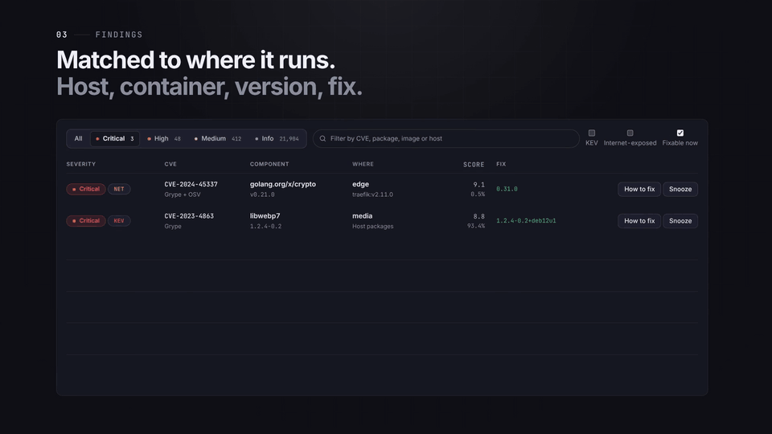

# vulnwatch

[](https://github.com/noah-ebrt/vulnwatch/actions/workflows/ci.yml)
[](LICENSE.md)

**Self-hosted vulnerability monitoring for your homelab or small network.**



```bash
curl -fsSL https://raw.githubusercontent.com/noah-ebrt/vulnwatch/main/install.sh | sh
```

vulnwatch keeps track of every Linux host, container and appliance in your network, checks them for known security
vulnerabilities every day, and tells you clearly what needs your attention: what is critical, what is merely
outdated, what is reachable from the internet, and which check could not run. It runs entirely on your own hardware
and its web interface is reachable only in your LAN.

**In short:**

- **One overview** of all hosts, containers and devices, with a clear red / yellow / green status.
- **Daily scans** of operating system packages and every running container image.
- **Concrete next steps:** which image or package to update, and the command to do it.
- **No silent gaps:** if a check fails, you see it. vulnwatch never reports "all clear" by leaving something out.
- **Secure by design:** agents open no ports, dangerous actions need your passkey, secrets are stored encrypted.

## Features

### Vulnerability scanning

- Scans the packages of each host and every running container image with two independent scanners,
  [Grype](https://github.com/anchore/grype) and [OSV-Scanner](https://github.com/google/osv-scanner).
- Rates every finding with fixed, predictable rules. It weighs whether a fix exists, whether the vulnerability is
  actively exploited ([CISA KEV](https://www.cisa.gov/known-exploited-vulnerabilities-catalog)), how likely
  exploitation is ([EPSS](https://www.first.org/epss/)) and whether the affected service is exposed to the internet.
- Groups findings by host and image and turns them into next steps, such as "pull the newest image and recreate the
  container" or "remove the old kernel packages, then install the updates", including the exact command.
- Shows pending security updates and hosts that need a reboot.

### Every device, with or without an agent

- **Linux hosts** run a small agent (`.deb` / `.rpm`, amd64 and arm64). It sees Docker and Podman (rootful and
  rootless) and, on bare-metal hosts, disk and pool health (SMART, ZFS, software RAID).
- **Appliances** are read through their own API, read-only: TrueNAS, Home Assistant, Proxmox VE, Synology DSM and
  OPNsense (version, pending updates, apps, alerts, storage health; for Proxmox also which VMs and containers have no
  agent yet).
- **Anything else** that can run a small scheduled script reports through the collector API. Ready-made scripts exist
  for Unraid, UGREEN, Synology and OpenWrt.

### Internet exposure

- Learns which services are reachable from the internet by reading, read-only, Nginx Proxy Manager, Traefik labels,
  Cloudflare Tunnel and the port forwards of a FRITZ!Box, OPNsense or UniFi router.
- Checks proxy host names against public DNS and rates findings on exposed services higher.
- Warns before the certificates in Nginx Proxy Manager expire.

### Versions and end of life

- Compares every running image with its registry: is the tag outdated, is a newer version available?
- Flags software whose release line has reached its end of life (from [endoflife.date](https://endoflife.date)).

### Health and uptime monitoring

- Tracks uptime and response times of every host. Agents are monitored automatically.
- Other devices get ping, TCP, HTTP(S), TLS certificate expiry, DNS, FRITZ!Box presence, internet and heartbeat checks.
- A read-only API and webhooks pass the current state on to status LEDs, Home Assistant or your own scripts.

### Reports and alerts

- A daily report and immediate alerts for new critical findings, through mail or any push service supported by
  [Apprise](https://github.com/caronc/apprise) (ntfy, Telegram, Signal and many more).
- Optional offsite watchdog (Healthchecks, Uptime Kuma or any URL) that notices when vulnerability monitoring itself
  stops.
- Optional Prometheus metrics.

### AI early warning (optional)

- Reads global security feeds every two hours and runs a daily AI-assisted web search, narrowed to the images,
  operating systems and packages you actually run. Works with Anthropic, OpenAI or a local model through Ollama.
- The AI only finds and summarizes; whether your version is affected is decided in code, not by the model.
- A relevant hit arrives right away with its severity and the command to fix it on each host, or the vendor's
  mitigation when no fix exists yet.

### Results you can trust

- A **coverage matrix** shows every system × check as *ok*, *finding*, *queued* or *error*, and every exposure source
  as a check of its own.
- A **canary scan** in every run proves that the scanner still detects a known vulnerability.
- Findings can be **snoozed** and hosts **excluded**, always with a reason and an end date, so nothing disappears for
  good by accident.
- An alarm fires when the number of findings drops sharply, a typical sign of a broken scan rather than real fixes.

## Security

vulnwatch watches over your network, so it is built to never become the weak spot itself:

- **Agents open no ports.** They connect out to the master over HTTPS and trust only its own pinned certificate
  authority. Data collection runs as root without network access; the networked part runs unprivileged.
- **No remote shell.** The master can send only a fixed list of harmless commands (report now, disk usage, failed
  services, listening ports, uptime). Reboots, agent updates and removal must be confirmed with your passkey, and the
  agent verifies that signature itself.
- **Signed agent builds.** Every installation builds its agents from this repository and signs them with its own key.
  Agents install only signed, newer releases.
- **Protected secrets.** API keys, passwords and notification URLs are stored with AES-256 encryption, are never
  shown again, and are only ever sent to the address they were entered for.
- **Hardened login.** Password plus authenticator app or passkey, CSRF protection and rate limits. All containers
  run read-only, unprivileged and without Linux capabilities.

The full threat model, including what a compromised master or agent could and could not do, is in
[SECURITY.md](SECURITY.md). Please report vulnerabilities privately as described there.

## How it works

```
 Linux hosts                                  Master: one Docker host in your LAN
 ┌─────────┐   outbound HTTPS, pinned CA    ┌──────────────────────────────────────┐
 │  agent  │ ─────────────────────────────► │ proxy   Caddy with its own CA        │
 └─────────┘                                │ server  web UI, API, rules, reports  │ ──► mail / push
                                            │ worker  Grype + OSV-Scanner          │ ◄── vulnerability databases
 NAS, router, hypervisor ◄── read-only API ─│                                      │
                                            └──────────────────────────────────────┘
```

1. Agents and collectors send an inventory of packages and containers; connectors read appliances through their API.
2. Every night (or on **Scan now**) the worker scans the inventories. It handles this untrusted input in its own
   container, without access to the database or the encryption key.
3. The server rates the findings, updates the overview and coverage, and sends the report and alerts.

## Requirements

- A Linux host in your LAN with Docker and the Compose plugin.
- 4 GB RAM or more. Grype alone (`VULNWATCH_SCANNERS=grype`) needs less and is about five times faster; measured
  figures for both modes are in [docs/INSTALL.md](docs/INSTALL.md).
- About 5 GB of disk for the scanner databases and the 90-day raw data archive.
- Outbound HTTPS from that host (vulnerability databases, container registries, endoflife.date).
- A DNS name for the master in your LAN, `vulnwatch.lan` by default: one entry in your router or DNS server
  (AdGuard, Pi-hole, …), or in the hosts file of the machine you browse from. Browsers allow passkeys only on a name,
  not on a bare IP address. Agents can use the IP.

## Quick start

```bash
curl -fsSL https://raw.githubusercontent.com/noah-ebrt/vulnwatch/main/install.sh | sh
```

The script clones the repository to `./vulnwatch`, asks for the LAN IP (detected) and a DNS name (`vulnwatch.lan`),
writes `deploy/.env`, runs `docker compose up -d --build` and prints the setup token. The first build takes a few
minutes, because it also builds and signs the agent. To read the script before it runs:

```bash
git clone https://github.com/noah-ebrt/vulnwatch.git vulnwatch && cd vulnwatch
less install.sh && ./install.sh
```

Manual setup without the script: [docs/INSTALL.md](docs/INSTALL.md#2-configure-and-start).

Open `https://<name or IP>:8443` and accept the certificate warning once (or trust the CA, see
[docs/INSTALL.md](docs/INSTALL.md#trust-the-certificate-authority)). The setup wizard asks for the setup token from
the log, then creates your admin account with password and authenticator app.

Then, in this order:

1. **Settings → System → Passkeys:** add a passkey. It confirms reboots and agent updates and signs the list of keys
   your agents trust, so add it before the first host. Trust the CA first: browsers allow passkeys only with a
   trusted certificate.
2. **Systems → Add Linux agent:** copy the setup command, run it on the host, compare the pairing code, approve.
3. **Settings → Alerts & reports → Channels:** add a mail or push channel and send a test.
4. Optional: offsite watchdog, exposure sources, appliances, AI provider, Prometheus metrics.

The first full run starts at the scheduled time (default 03:00), or right away with **Scan now** on the overview.
The first run also downloads the scanner databases; later runs reuse them.

**Updating:** `git pull && docker compose up -d --build` in `deploy/`. When the agent changed, **Systems** offers the
new version within a minute, and **Update all** installs it on every host with one passkey touch.

## Documentation

| Guide | Contents |
| --- | --- |
| [docs/INSTALL.md](docs/INSTALL.md) | Installation, DNS and certificates, updates, backup and restore, moving to another host, troubleshooting |
| [docs/AGENTS.md](docs/AGENTS.md) | Adding hosts, what an agent collects, commands, updates, removal, changing the agent |
| [docs/HEALTH.md](docs/HEALTH.md) | Health monitoring: checks, thresholds, alerts, router checks, heartbeat, API and webhooks |
| [docs/INTEGRATIONS.md](docs/INTEGRATIONS.md) | Notifications, schedule, snooze and exclusions, watchdog, exposure sources, appliances, collectors, version check, AI early warning, configuration as JSON, Prometheus, what leaves your network |
| [collectors/README.md](collectors/README.md) | Collector scripts for Unraid, Synology and OpenWrt, and the report format for your own |
| [SECURITY.md](SECURITY.md) | Threat model and how to report a vulnerability |
| [docs/INTERNALS.md](docs/INTERNALS.md) | Architecture and data flow for contributors |

## Development

```bash
# server (Python 3.12)
cd server && python3 -m venv .venv && .venv/bin/pip install --require-hashes -r requirements-dev.txt
.venv/bin/pytest

# web UI (Node 22)
cd web && npm ci && npm test && npm run build

# agent (Go): the tests run in the build image, no local Go needed
cd deploy && docker compose build agent-build
```

Dependencies are pinned with hashes and taken no earlier than 7 days after their release (`web/.npmrc`,
`uv pip compile --exclude-newer`). Changing the agent and rolling it out is described in
[docs/AGENTS.md](docs/AGENTS.md#change-the-agent). Contributions are welcome, see [CONTRIBUTING.md](CONTRIBUTING.md).

## Scope and status

vulnwatch is in daily use on a homelab with four hosts. It is a risk overview and alerting tool: it does not replace
endpoint protection (EDR) and does not install patches for you. Windows hosts are not supported yet. Support is best
effort.

Nothing phones home. Everything that leaves your network is listed in
[docs/INTEGRATIONS.md](docs/INTEGRATIONS.md#what-leaves-your-network).

## License

[PolyForm Noncommercial 1.0.0](LICENSE.md). Personal, homelab, research and non-profit use, modification and sharing
are free. Commercial use requires a separate license from the author. This makes vulnwatch source-available, not open
source in the OSI sense.
